# 备考助手 · 后端技术实现文档 v1.1

> 状态：可进入编码  
> 版本日期：2026-11-17  
> 项目：exam-assistant（当前目录 exam-assiant）  
> 适用阶段：一期 M1–M3  
> 配套文档：[备考助手-产品定义.md](./备考助手-产品定义.md)、[备考助手-页面设计稿.html](./备考助手-页面设计稿.html)、[一期实施计划-后端.md](./一期实施计划-后端.md)
>
> v1.1 变更：确认启用**用户自带 LLM Key**，随用户信息配置、加密落库；新增 `LLM_KEY_NOT_CONFIGURED` 错误码与前端配置引导链路；补充密钥安全设计。

## 0. 文档说明

### 0.1 本文档解决什么

`一期实施计划-后端.md` 定义了"要做什么、按什么顺序做"，并引用了一份尚不存在的《后端数据状态技术方案.md》。本文档补齐两块落地所必需的设计：

1. **用户数据的状态流程图**：把散落在产品定义和实施计划中的状态规则，收敛为可实现、可测试的状态机，明确每个状态由哪张表、哪个字段、哪个条件派生。
2. **接口定义**：给出每个接口的请求、响应、错误码、状态副作用，作为前后端联调的直接契约。

### 0.2 权威性约定

当文档之间出现表述差异时，按以下优先级取值：

| 优先级 | 文档 | 权威范围 |
|---|---|---|
| 1 | 产品定义 v0.2 | 业务规则、判分口径、统计口径 |
| 2 | 一期实施计划-后端 v1.1 | 技术栈、表结构、接口清单、一期边界 |
| 3 | 页面设计稿 | 页面字段、交互状态、展示口径 |
| 4 | 前端 `src/types.ts` / `src/api/client.ts` | 实际字段命名与调用签名（camelCase） |

> 注意：前端当前使用 `localStorage` mock，其类型定义是"目标契约"而非"既有后端实现"。后端实现后需保持这些签名不变，或同步修改前端。差异项见第 9 章。

---

## 1. 范围与边界

### 1.1 一期后端必须交付

- M1：认证、考试/类目/题目 CRUD、客观题作答、错题本、统计。
- M2：AI 文本导入、分块解析、去重、类目归并、校对确认、任务进度。
- M3：简答题 AI 判分、采分点反馈、超时降级、申诉翻转、统计预聚合。

### 1.2 明确不做

真实邮件发送、文件解析（PDF/Word/Excel）、算法题、AI 变式题、间隔重复算法、练习进度持久化、分享/社区/排行榜、移动端原生适配。

> 特别注意：产品定义与设计稿 P8 都提到"退出保留进度/断点续答"，但实施计划已明确**一期不持久化练习进度**。以实施计划为准，P8 的"保存进度"在后端不提供接口。详见 9.2。

---

## 2. 技术架构

### 2.1 技术栈

| 层 | 选型 |
|---|---|
| 运行时 | Node.js 22 |
| 框架 | Fastify + TypeScript |
| 参数校验 | Zod（schemas 放 `packages/shared`） |
| 数据库 | PostgreSQL 16（Docker Compose 提供） |
| ORM | Prisma |
| 鉴权 | JWT access token + refresh token（哈希落库） |
| 密码 | bcrypt |
| LLM | DeepSeek `deepseek-chat`，OpenAI 兼容接口，经 Provider 抽象 |
| 测试 | Vitest + Supertest |

### 2.2 分层与调用方向

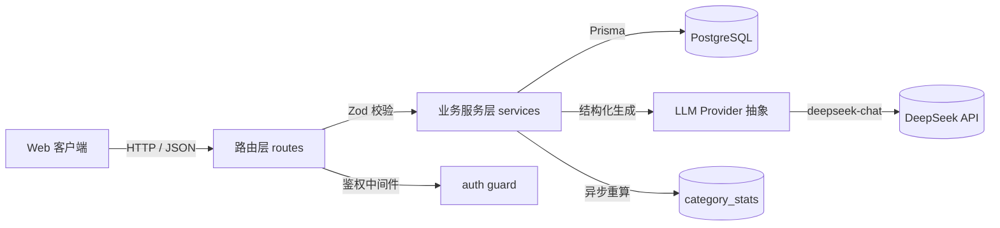

分层约束：

- 路由层只处理 HTTP 参数、鉴权、响应包装，不写业务逻辑。
- 业务服务层处理归属校验、状态流转、事务；所有查询强制带 `user_id`。
- Prisma 访问集中在服务层或仓储层，不在路由层直接调用。
- LLM 调用必须经过 `LLMProvider` 接口，业务层不感知具体厂商。
- 所有请求、响应、LLM 结构化输出都用 Zod 校验。

### 2.3 横切约定

| 项 | 约定 |
|---|---|
| 字段命名 | HTTP 请求/响应统一 **camelCase**；数据库 **snake_case**，由 Prisma `@map` 映射 |
| ID | 主键用 UUID（`crypto.randomUUID()`），前缀不做业务含义 |
| 时间 | ISO 8601 字符串（UTC，`Z` 结尾） |
| 鉴权 | 除注册/登录/刷新/健康检查外，全部接口需 `Authorization: Bearer <accessToken>` |
| 请求体 | `Content-Type: application/json` |
| 校验失败 | HTTP 400，错误码 `VALIDATION_ERROR`，`details` 给出字段级错误 |
| 幂等 | 创建类接口依赖业务唯一约束（邮箱、`exam_id + stem_hash`）防重复 |

---

## 3. 数据模型

### 3.1 实体关系

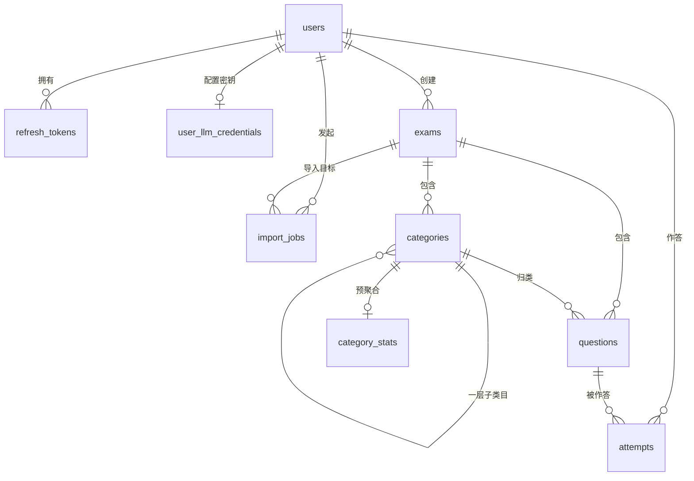

### 3.2 表与状态相关字段

| 表 | 关键字段 | 与状态机的关系 |
|---|---|---|
| `users` | id, email(unique), password_hash, nickname, avatar_url, created_at | 认证主体 |
| `user_llm_credentials` | id, user_id(unique), provider, model, token_ciphertext, token_iv, token_tag, token_masked, configured, updated_at | **用户自带 Key**，加密存储；与 users 一对一，配置入口在用户信息表单 |
| `refresh_tokens` | id, user_id, token_hash, expires_at, revoked_at, created_at | 会话状态（有效/已撤销/已过期） |
| `exams` | id, user_id, name, description, exam_date, created_at | 数据隔离边界 |
| `categories` | id, exam_id, user_id, parent_id, name, sort_order | 统计聚合的树节点，仅一层子类目 |
| `questions` | id, exam_id, category_id, type, stem, options_json, answer, explanation, stem_hash, created_at | `unique(exam_id, stem_hash)` 去重 |
| `attempts` | id, user_id, question_id, answer_json, is_correct, score, ai_score, ai_feedback, overridden, original_attempt_id, duration_ms, answer_hash, created_at | **只增不改**，所有状态与统计的唯一事实来源 |
| `import_jobs` | id, user_id, exam_id, target_category_id, raw_text, status, progress_json, result_json, error, prompt_version, model, token_usage, created_at, updated_at | 导入任务状态机载体 |
| `category_stats` | id, category_id, total, passed, answer_count, error_count, error_rate, updated_at | 答题后异步重算当前节点及父链 |

### 3.3 关键口径（SQL 层）

| 指标 | 计算方式 | 备注 |
|---|---|---|
| 题目数 | `count(questions)` where `category_id` 在子树内 | 父节点 = 自身 + 子节点 |
| 已过关数 | `count(distinct question_id)` from attempts where `is_correct = true` | 答对一次即过关 |
| 错误率 | `sum(is_correct = false) / count(*)` | 分母排除 `is_correct IS NULL` 的待自评记录 |
| 待订正数 | 存在 `is_correct=false` 且最新一条 `is_correct!=true` 的题目数 | 错题本派生 |
| 最近练习时间 | `max(attempts.created_at)` | 首页卡片 |

> 统计查询必须带 `user_id` 过滤——这是多人共用后最容易漏掉的隐蔽 bug。

---

## 4. 用户数据状态流程图

本章是后端实现的核心参照。**所有"题目状态"都不是独立字段，而是从 `attempts` 流水派生的计算结果**（`attempts` 只增不改，保证统计可追溯）。前端展示时按 4.7 的映射表投影。

### 4.1 状态域总览

用户核心数据围绕四类状态流转，彼此通过"提交作答"和"导入确认"两个动作串联：

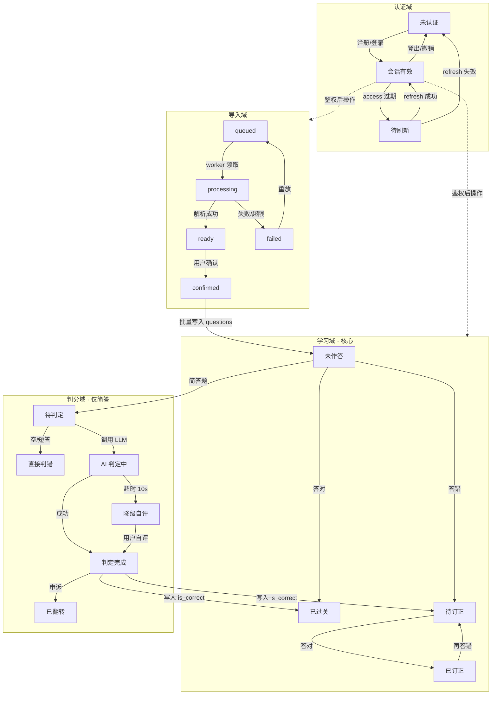

### 4.2 题目掌握状态机（passed 维度）

"过关"是一次性达成的永久状态：该题只要存在一条 `is_correct = true` 的流水即为已过关。后续答错不会撤销"已过关"，但会同时进入错题本（见 4.3）。

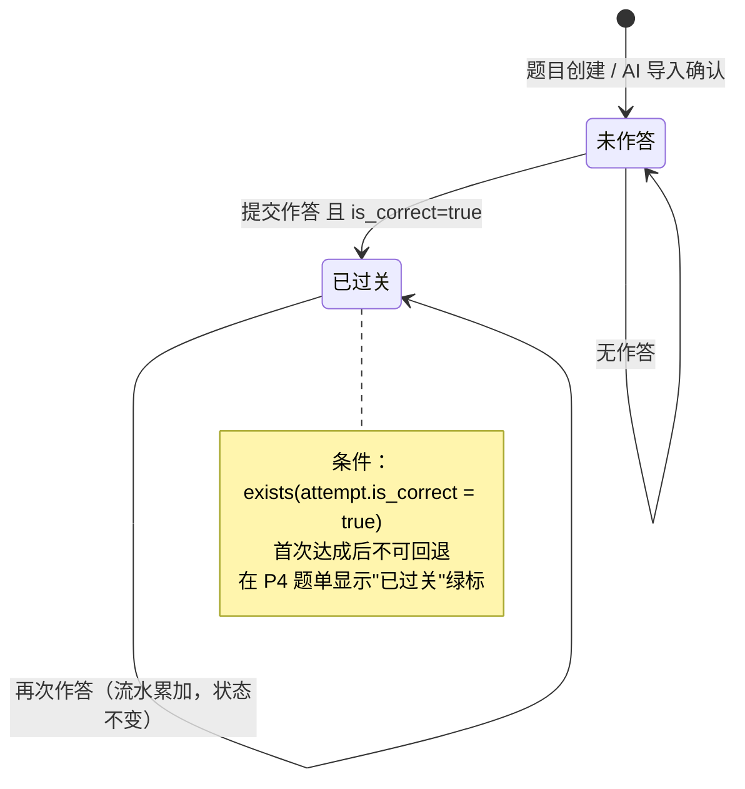

对应判定：

```
passed = exists(attempt where question_id = ? and is_correct = true)
```

### 4.3 错题本生命周期（wrongBook 维度）

错题本是"最近一次作答结果"的投影，与"是否过关"相互独立。一道题可以同时是"已过关"和"待订正"（说明它曾经答对过，但最近一次答错）。

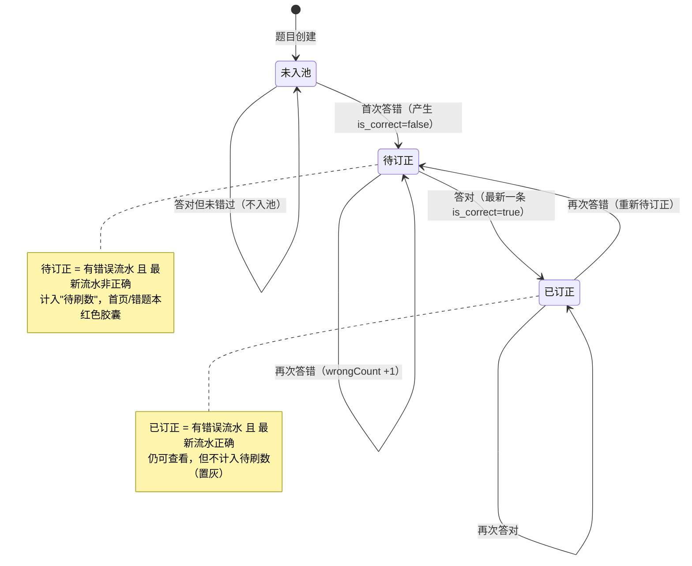

派生规则（供仓储层实现，参考前端 `getWrongBookItems` 逻辑）：

```
hasWrong  = exists(attempt where question_id = ? and is_correct = false)
latest    = 按 created_at 取最后一条 is_correct IS NOT NULL 的 attempt
入池      = hasWrong
待订正    = hasWrong and latest.is_correct = false
已订正    = hasWrong and latest.is_correct = true
wrongCount= count(attempt where is_correct = false)
```

### 4.4 简答题判分状态机

简答题不能在提交瞬间确定 `is_correct`，因此用 `is_correct = NULL` 表示"待判定"，由判分流程写入最终结果。`attempts` 保持只增不改：**降级自评与申诉翻转都通过新增流水实现**，不修改原记录。

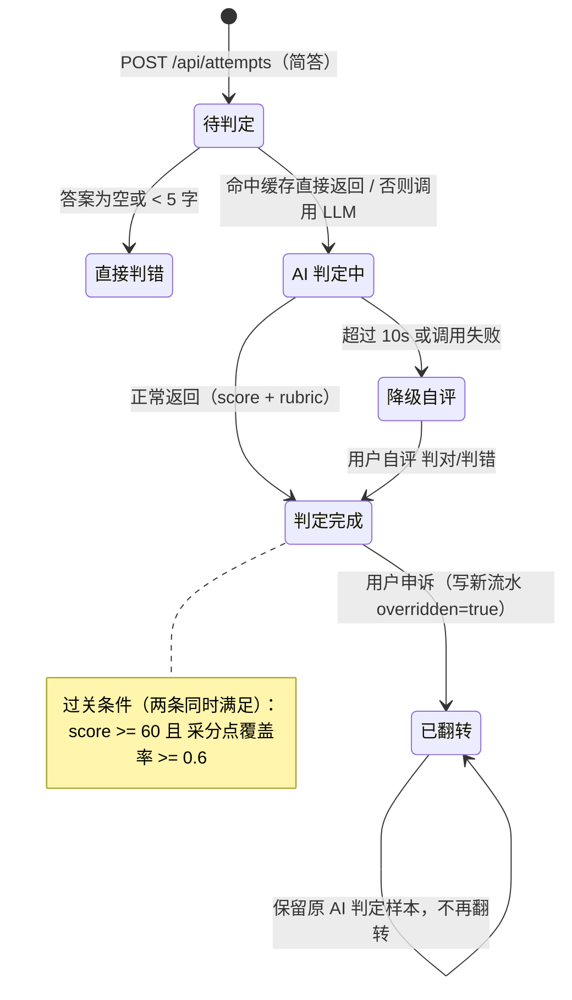

关键实现约束：

| 环节 | 规则 |
|---|---|
| 短路 | 答案空或 trim 后长度 < 5：直接 `is_correct=false`，不调用 LLM |
| 缓存 | `answer_hash = sha256(stem + normalized(answer))`，命中复用结果，不重复扣费 |
| 超时 | 10s 未返回：写一条 `is_correct=NULL` 的流水并返回，前端展示自评按钮 |
| 申诉 | 写一条新流水，`overridden=true`，`original_attempt_id` 指向原记录；**原 AI 判定保留**用于调 prompt |
| 统计 | `is_correct=NULL` 的流水不计入错误率分母；申诉流水以最终 `is_correct` 计入 |

### 4.5 导入任务状态机

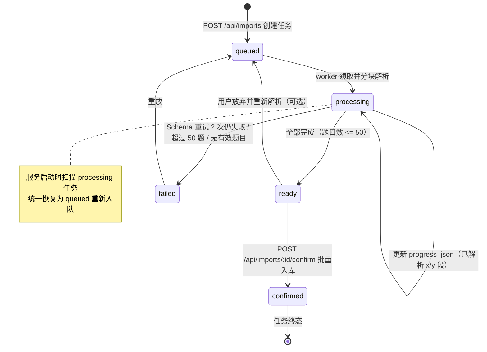

状态字段与前端展示：

| status | 前端表现（P7） | 可确认入库 |
|---|---|---|
| `queued` | "排队中" | 否 |
| `processing` | "AI 解析中 · 已解析 x/y 段"进度条 | 否 |
| `ready` | 校对表格可编辑，展示"确认导入（N）" | 是 |
| `failed` | 顶部错误 Banner + "去单个录入"兜底 | 否 |
| `confirmed` | 已完成，可关闭 | 否（终态） |

### 4.6 认证会话状态机

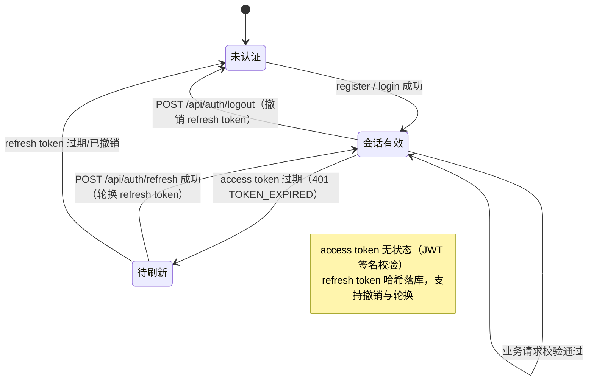

### 4.7 状态到前端展示的映射总表

| 展示位置 | 展示文案 | 判定条件 | 数据来源 |
|---|---|---|---|
| P2 考试卡片 | 已过关 79/128 + 进度条 | `passed` / `questionCount` | exams + category_stats |
| P2/P3 | 未练习（灰） | `answerCount = 0` | category_stats |
| P3 节点 | 错误率 <15% 绿 / 15–25% 琥珀 / >25% 红 | `errorRate` | category_stats |
| P4 题单 | 已过关（绿） | `passed = true` | attempts 派生 |
| P4 题单 | 未过关 · 错 N 次（红） | `passed = false and wrongCount > 0` | attempts 派生 |
| P4 题单 | 未作答（灰） | `answerCount = 0` | attempts 派生 |
| P8 简答 | 过关（绿）/ 未过关（红） | `score>=60 且 覆盖率>=0.6` | attempts.ai_feedback |
| P8 简答 | "我觉得我答对了"按钮 | `overridden = false` | attempts |
| P9 错题本 | 待订正（红，计入待刷） | `hasWrong and latest.is_correct=false` | attempts 派生 |
| P9 错题本 | 已订正（灰，不计入待刷） | `hasWrong and latest.is_correct=true` | attempts 派生 |
| P7 导入 | 置信 <0.7 琥珀高亮 | `confidence < 0.7` | import_jobs.result_json |

---

## 5. 接口约定

### 5.1 通用约定

- **Base URL**：`/api`（健康检查 `/health` 除外）
- **鉴权**：除 `register / login / refresh / health` 外，所有接口要求 `Authorization: Bearer <accessToken>`
- **成功响应**：直接返回业务数据（对象或数组），不额外包 `data` 层，与前端 `src/api/client.ts` 现有签名保持一致
- **错误响应**：HTTP 状态码 + 统一结构：

```json
{
  "statusCode": 409,
  "code": "CONFLICT",
  "message": "该考试下已存在相同题干",
  "details": { "field": "stem" },
  "requestId": "req_01HZY..."
}
```

### 5.2 错误码表

| HTTP | code | 含义 | 典型场景 |
|---|---|---|---|
| 400 | `VALIDATION_ERROR` | 参数校验失败 | Zod schema 不通过、题型与答案不自洽 |
| 401 | `UNAUTHORIZED` | 缺少凭证 | 未带 `Authorization` 头 |
| 401 | `TOKEN_EXPIRED` | access token 过期 | 前端收到后静默调用 refresh |
| 401 | `INVALID_CREDENTIALS` | 邮箱或密码错误 | 登录 |
| 403 | `FORBIDDEN` | 越权访问 | 资源 `user_id` 与当前用户不符 |
| 404 | `NOT_FOUND` | 资源不存在 | ID 不存在或已被删除 |
| 409 | `CONFLICT` | 业务唯一约束冲突 | 邮箱已注册、`exam_id + stem_hash` 重复 |
| 422 | `RULE_VIOLATION` | 业务规则不满足 | 子类目超出一层、单次导入超过 50 题 |
| 422 | `LLM_KEY_NOT_CONFIGURED` | 未配置大模型密钥 | 调用简答判分 / AI 导入前未配置用户 Key |
| 422 | `LLM_KEY_INVALID` | 密钥无效或不可用 | 用户 Key 被拒绝、额度耗尽、连通性校验失败 |
| 429 | `RATE_LIMITED` | 调用过频 | LLM 调用触发防刷阈值 |
| 500 | `INTERNAL_ERROR` | 服务内部错误 | 未捕获异常（记录 `requestId` 便于排查） |

> `LLM_KEY_NOT_CONFIGURED` / `LLM_KEY_INVALID` 是前端**必须特殊处理**的两个码：命中时弹出"需要配置大模型密钥"引导框，而非普通错误提示。处理链路见 6.9。

### 5.3 接口总览

| # | 模块 | 方法与路径 | 鉴权 | 说明 |
|---|---|---|---|---|
| 1 | 认证 | `POST /api/auth/register` | 否 | 注册并直接建立会话 |
| 2 | 认证 | `POST /api/auth/login` | 否 | 登录 |
| 3 | 认证 | `POST /api/auth/refresh` | refresh token | 换取新 access token |
| 4 | 认证 | `POST /api/auth/logout` | 是 | 撤销 refresh token |
| 5 | 认证 | `GET /api/auth/me` | 是 | 当前用户资料（含密钥配置状态与掩码，不含明文） |
| 6 | 认证 | `PATCH /api/auth/me` | 是 | 更新昵称/头像/LLM 配置（含加密保存用户 Key） |
| 6a | 认证 | `POST /api/auth/llm-config/verify` | 是 | 校验用户 Key 连通性（可选） |
| 7 | 考试 | `GET /api/exams` | 是 | 考试列表（含统计） |
| 8 | 考试 | `POST /api/exams` | 是 | 新建考试 |
| 9 | 考试 | `GET /api/exams/:id` | 是 | 考试详情 |
| 10 | 考试 | `PATCH /api/exams/:id` | 是 | 编辑考试 |
| 11 | 考试 | `DELETE /api/exams/:id` | 是 | 删除考试及级联数据 |
| 12 | 类目 | `GET /api/categories?examId=` | 是 | 类目树（含统计） |
| 13 | 类目 | `POST /api/categories` | 是 | 新建类目（含子类目） |
| 14 | 类目 | `PATCH /api/categories/:id` | 是 | 重命名 |
| 15 | 类目 | `DELETE /api/categories/:id` | 是 | 删除类目及子树 |
| 16 | 题目 | `GET /api/questions?examId=&categoryId=` | 是 | 题单（含作答状态） |
| 17 | 题目 | `POST /api/questions` | 是 | 单题录入（P6） |
| 18 | 题目 | `GET /api/questions/:id` | 是 | 单题详情 |
| 19 | 题目 | `PATCH /api/questions/:id` | 是 | 编辑题目 |
| 20 | 题目 | `DELETE /api/questions/:id` | 是 | 删除题目 |
| 21 | 作答 | `POST /api/attempts` | 是 | 提交作答（统一入口） |
| 22 | 作答 | `GET /api/questions/:id/attempts` | 是 | 单题历史作答 |
| 23 | 作答 | `POST /api/attempts/:id/override` | 是 | 简答自评 / 申诉翻转 |
| 24 | 练习 | `POST /api/practice/session` | 是 | 生成一次练习的题目序列 |
| 25 | 错题本 | `GET /api/wrong-book` | 是 | 错题列表（含已订正） |
| 26 | 导入 | `POST /api/imports` | 是 | 创建 AI 导入任务 |
| 27 | 导入 | `GET /api/imports/:id` | 是 | 查询任务进度与解析结果 |
| 28 | 导入 | `POST /api/imports/:id/confirm` | 是 | 校对确认后批量入库 |
| 29 | 导入 | `POST /api/imports/:id/retry` | 是 | 失败任务重放 |
| 30 | 统计 | `GET /api/stats/:examId` | 是 | 考试维度汇总统计 |
| 31 | 系统 | `GET /health` | 否 | 健康检查（已实现） |

---

## 6. 接口定义

> 下表中 `Body` 字段均为 camelCase，对应前端 `src/types.ts` 的 Input 类型；后端用 Zod 校验后再映射为数据库 snake_case。

### 6.1 认证模块

#### 6.1.1 POST /api/auth/register

- 说明：注册成功后**直接建立会话**（前端 P1 不二次登录），返回 access/refresh token 与用户信息。
- 鉴权：无。

| Body 字段 | 类型 | 必填 | 校验 |
|---|---|---|---|
| email | string | 是 | 合法邮箱格式，trim + lowercase |
| password | string | 是 | 8–72 字符（bcrypt 上限） |
| nickname | string | 否 | 空则用 email 前缀 |

响应 `200`：

```json
{
  "user": {
    "id": "9f2c...",
    "email": "you@example.com",
    "nickname": "备考人",
    "avatarUrl": null,
    "llmConfig": {
      "provider": "deepseek",
      "model": "deepseek-chat",
      "configured": false,
      "apiTokenMasked": null
    }
  },
  "accessToken": "eyJhbGciOi...",
  "refreshToken": "rt_9f2c...",
  "expiresIn": 3600
}
```

- 副作用：写 `users`；`password` 经 bcrypt 哈希；写一条 `refresh_tokens`（token_hash 落库）。
- 错误：`409 CONFLICT`（邮箱已注册）、`400 VALIDATION_ERROR`。
- 状态流转：未认证 → 会话有效。

#### 6.1.2 POST /api/auth/login

- 鉴权：无。Body：`email`、`password`（均必填）。
- 响应：同 6.1.1。
- 实现要点：无论"邮箱不存在"还是"密码错误"都返回 `401 INVALID_CREDENTIALS`，避免账号枚举；bcrypt 比较需用固定耗时路径。
- 错误：`401 INVALID_CREDENTIALS`、`400 VALIDATION_ERROR`。

#### 6.1.3 POST /api/auth/refresh

| Body 字段 | 类型 | 必填 |
|---|---|---|
| refreshToken | string | 是 |

响应 `200`：`{ "accessToken": "...", "refreshToken": "rt_new...", "expiresIn": 3600 }`

- 实现要点：**轮换** refresh token——旧 token 置 `revoked_at`，签发新 token 落库；校验 `expires_at > now()` 且 `revoked_at IS NULL`。
- 错误：`401 TOKEN_EXPIRED`、`401 UNAUTHORIZED`、`403 FORBIDDEN`（token 与用户不匹配）。
- 状态流转：待刷新 → 会话有效；失败则 → 未认证。

#### 6.1.4 POST /api/auth/logout

- 鉴权：是。Body：无（或传 `refreshToken` 精确撤销）。
- 响应 `200`：`{ "ok": true }`
- 副作用：将当前用户所有有效 `refresh_tokens` 置 `revoked_at`；access token 无状态，天然失效于过期。
- 状态流转：会话有效 → 未认证。

#### 6.1.5 GET /api/auth/me

- 鉴权：是。响应 `200`：返回 `AuthUser` 对象（同 6.1.1 的 `user` 字段）。
- 用途：前端刷新页面后恢复登录态。
- **密钥字段**：`llmConfig` 只含 `configured` 与 `apiTokenMasked`，**绝不含明文 Key**。

#### 6.1.6 PATCH /api/auth/me

- 说明：对应前端 SettingsPage 的 `updateProfile`，是**用户配置自带 Key 的入口**（与昵称、头像、模型一起提交）。

| Body 字段 | 类型 | 必填 | 校验 |
|---|---|---|---|
| nickname | string | 是 | trim 后非空 |
| avatarUrl | string \| null | 否 | 一期可存字符串 URL，不提供上传 |
| llmConfig | object | 否 | 见下表；不传则保持原配置 |
| llmConfig.provider | enum | 否 | 仅允许 `deepseek` |
| llmConfig.model | enum | 否 | `deepseek-chat` / `deepseek-pro` |
| llmConfig.apiToken | string \| null | 否 | 传入新 Key 则加密覆盖；传 `null` 或空串则清空（`configured=false`）；**不传则保持原 Key 不变** |

响应 `200`：更新后的 `AuthUser`（`llmConfig` 仅含 `configured` + `apiTokenMasked`，不回显明文）。

- 副作用：`apiToken` 非空时用 AES-256-GCM 加密写 `user_llm_credentials`（`upsert`），计算掩码；为空则清空密文字段。
- 安全：明文 Key 仅在本次请求体内出现；响应、日志、错误信息均不含明文。
- 错误：`400 VALIDATION_ERROR`、`401 UNAUTHORIZED`。

> 前端注意：编辑昵称等非密钥字段时若未修改 Key，**不要传 `apiToken`**，否则会清空已配置密钥；回显时用 `apiTokenMasked`，不要尝试填充明文。

#### 6.1.7 POST /api/auth/llm-config/verify（可选）

- 说明：保存 Key 前做一次最小成本连通性校验，避免"保存成功但调用失败"。
- Body：`{ "provider": "deepseek", "model": "deepseek-chat", "apiToken": "sk-..." }`（传 `apiToken` 校验新值；不传则校验已保存的配置）。
- 响应 `200`：`{ "valid": true, "masked": "sk-****************abcd" }`。
- 错误：`422 LLM_KEY_INVALID`（`details.reason` 给出"密钥错误 / 额度不足 / 网络不通"，**不含 Key 原文**）、`422 LLM_KEY_NOT_CONFIGURED`。
- 实现：调用 DeepSeek 一次 `max_tokens=1` 的极小请求；成功即 valid。仅为校验用途，不写库。

### 6.2 考试模块

对象结构 `Exam`：

```json
{
  "id": "exam_...",
  "name": "2026 下半年教资笔试",
  "description": "",
  "examDate": "2026-09-12",
  "categoryCount": 4,
  "questionCount": 128,
  "passedCount": 79,
  "lastPracticedAt": "2026-11-16T09:12:00.000Z",
  "createdAt": "2026-10-01T08:00:00.000Z"
}
```

- `categoryCount` 只统计顶层类目（`parent_id IS NULL`）。
- `passedCount` = `count(distinct question_id where is_correct=true)`。

#### 6.2.1 GET /api/exams

- 鉴权：是。Query：无。响应 `200`：`Exam[]`，按 `createdAt` 倒序。
- 空数组时前端展示"还没有考试，创建第一个开始备考"。
- 实现：单条 SQL 聚合，避免 N+1（用 `groupBy` + `leftJoin` 预聚合）。

#### 6.2.2 POST /api/exams

| Body 字段 | 类型 | 必填 | 校验 |
|---|---|---|---|
| name | string | 是 | trim 后非空，≤ 60 字符 |
| description | string | 否 | 默认空串 |
| examDate | string \| null | 否 | `YYYY-MM-DD` |

响应 `201`：新建的 `Exam`（统计字段为 0/null）。

#### 6.2.3 GET /api/exams/:id

- Path：`id`。响应 `200`：`Exam`。
- 错误：`404 NOT_FOUND`（不存在或不属于当前用户——两种都返回 404，避免泄露存在性）。

#### 6.2.4 PATCH /api/exams/:id

- Body：同 6.2.2，字段可部分提交。响应 `200`：更新后的 `Exam`。
- 错误：`404 NOT_FOUND`、`400 VALIDATION_ERROR`。

#### 6.2.5 DELETE /api/exams/:id

- 响应 `200`：`{ "ok": true }`
- 副作用（单事务）：删除 exam → 级联删除 categories、questions、相关 attempts、相关 import_jobs、相关 category_stats。
- 错误：`404 NOT_FOUND`。

### 6.3 类目模块

对象结构 `Category`：

```json
{
  "id": "cat_...",
  "examId": "exam_...",
  "parentId": null,
  "name": "教育心理学",
  "sortOrder": 1,
  "stats": {
    "total": 56,
    "passed": 31,
    "answerCount": 240,
    "errorCount": 54,
    "errorRate": 0.225
  }
}
```

- `stats` 读 `category_stats` 预聚合表；`errorRate` 为 `null` 时前端显示"未练习"。

#### 6.3.1 GET /api/categories?examId=

| 参数 | 位置 | 必填 | 说明 |
|---|---|---|---|
| examId | query | 是 | 目标考试 ID |

响应 `200`：`Category[]`（扁平数组，前端按 `parentId` 组织成树；顶层在前，`sortOrder` 升序）。

- 错误：`404 NOT_FOUND`（考试不存在或越权）。

#### 6.3.2 POST /api/categories

| Body 字段 | 类型 | 必填 | 校验 |
|---|---|---|---|
| examId | string | 是 | 必须属于当前用户 |
| parentId | string \| null | 否 | 默认 null；非 null 时父节点必须存在且其 `parentId = null` |
| name | string | 是 | trim 后非空 |

响应 `201`：`Category`（`sortOrder` 由服务端取同级最大值 +1）。
错误：`422 RULE_VIOLATION`（父节点已是子类目，违反"只支持一层"）、`404 NOT_FOUND`、`409 CONFLICT`（同级重名，可选）。

#### 6.3.3 PATCH /api/categories/:id

- Body：`{ "name": string }`。响应 `200`：`Category`。错误：`404 NOT_FOUND`、`400 VALIDATION_ERROR`。

#### 6.3.4 DELETE /api/categories/:id

- 响应 `200`：`{ "ok": true }`
- 副作用（单事务）：删除该节点及其直接子节点；删除子树内 questions 及其 attempts；重算受影响父节点的 `category_stats`。
- 错误：`404 NOT_FOUND`。

### 6.4 题目模块

对象结构 `Question`：

```json
{
  "id": "q_...",
  "examId": "exam_...",
  "categoryId": "cat_...",
  "type": "single_choice",
  "stem": "根据学习动机的内驱力理论……（　）",
  "options": ["A. 认知内驱力", "B. 自我提高内驱力", "C. 附属内驱力", "D. 成就动机"],
  "answer": "C",
  "explanation": "附属内驱力指……",
  "stemHash": "a9f3...",
  "createdAt": "2026-11-01T10:00:00.000Z"
}
```

> `answer` 统一存字符串：单选 `"C"`；多选 `"[\"A\",\"C\"]"`（JSON 数组字符串）；填空/简答为参考答案文本。与前端 `types.ts` 保持一致。

`QuestionInput`（创建/编辑共用）：

| 字段 | 类型 | 必填 | 校验规则 |
|---|---|---|---|
| examId | string | 是 | 属于当前用户 |
| categoryId | string | 是 | 属于该 exam |
| type | enum | 是 | `single_choice` / `multi_choice` / `fill_blank` / `short_answer` |
| stem | string | 是 | trim 后非空 |
| options | string[] | 条件 | 选择题必填且 ≥2；填空/简答忽略 |
| answer | string | 是 | 单选：`^[A-Z]$` 且在选项范围内；多选：字母数组 JSON 且非空；填空/简答非空文本 |
| explanation | string | 否 | 默认空串 |

#### 6.4.1 GET /api/questions

| 参数 | 位置 | 必填 | 说明 |
|---|---|---|---|
| examId | query | 是 | 考试 ID |
| categoryId | query | 否 | 传入时包含其直接子节点下的题目（一层子树） |

响应 `200`：`Question[]`（按 `createdAt` 升序）。

> P4 题单还需展示"已过关 / 错 N 次 / 作答 N 次"。为避免 N+1，建议响应增加可选字段 `answerState`（数组元素附带 `passed`、`wrongCount`、`answerCount`），由服务层一次聚合后回填。前端 `types.ts` 当前无此字段，属于待对齐项（9.3）。

#### 6.4.2 POST /api/questions

- Body：`QuestionInput`。响应 `201`：`Question`。
- 实现：计算 `stemHash`（trim → lowercase → 去所有空白 → 去中英文标点），查 `unique(exam_id, stem_hash)`。
- 错误：`409 CONFLICT`（同考试下重复题干 → 前端提示"已有同题"）、`400 VALIDATION_ERROR`（题型与答案不自洽）、`404 NOT_FOUND`。

#### 6.4.3 GET /api/questions/:id

- 响应 `200`：`Question`。错误：`404 NOT_FOUND`（越权同样返回 404）。

#### 6.4.4 PATCH /api/questions/:id

- Body：`QuestionInput`（全量）。响应 `200`：更新后的 `Question`。
- 实现：重算 `stemHash`，去重时排除自身；题干变更后历史 attempts 不迁移。
- 错误：`409 CONFLICT`、`400 VALIDATION_ERROR`、`404 NOT_FOUND`。

#### 6.4.5 DELETE /api/questions/:id

- 响应 `200`：`{ "ok": true }`
- 副作用（单事务）：删除题目及其 attempts；重算所属类目及父链统计。

### 6.5 作答模块

#### 6.5.1 POST /api/attempts（统一作答入口）

| Body 字段 | 类型 | 必填 | 说明 |
|---|---|---|---|
| questionId | string | 是 | 题目 ID（须属于当前用户） |
| answer | string | 是 | 单选字母 / 多选字母数组 JSON / 填空文本 / 简答文本 |
| durationMs | number | 否 | 作答耗时，落 `duration_ms` |

响应 `200`：新建的 `Attempt` 对象：

```json
{
  "id": "att_...",
  "userId": "9f2c...",
  "questionId": "q_...",
  "answer": "A",
  "answerJson": null,
  "isCorrect": true,
  "score": 100,
  "aiScore": null,
  "aiFeedback": null,
  "overridden": false,
  "originalAttemptId": null,
  "durationMs": 4200,
  "createdAt": "2026-11-17T07:12:00.000Z"
}
```

**服务端判定分支**（这是本接口的核心）：

| 题型 | 判定方式 | `is_correct` | 是否调 LLM |
|---|---|---|---|
| 单选 | 答案字母比对 | true / false | 否 |
| 多选 | 集合相等（排序后比对） | true / false | 否 |
| 填空 | 归一化后比对（忽略空格、全角标点、大小写） | true / false | 否 |
| 简答（空或 <5 字） | 短路判错 | false | 否 |
| 简答（命中缓存） | 复用 `answer_hash` 结果 | true / false | 否 |
| 简答（正常） | LLM 一次调用 | 按 4.4 规则 | 是 |
| 简答（超时/失败） | 写待自评流水 | `null` | 是（10s 中止） |

**密钥门禁**：命中"简答（正常）"分支时，调用 LLM 前先检查当前用户是否已配置有效 Key：

- 未配置 → 返回 `422 LLM_KEY_NOT_CONFIGURED`，**不写入 attempt**（避免产生无法判分的流水）。
- 已配置但 Provider 校验失败（401/额度耗尽）→ 返回 `422 LLM_KEY_INVALID`。
- 短路判错与缓存命中**不需要 Key**，即使未配置也正常返回，保证短答与重复作答不受阻断。
- 门禁在**入口同步完成**，不做成异步失败，确保前端能立即弹出配置引导框。

简答成功时 `aiFeedback` 结构（Zod 校验后落 JSON）：

```json
{
  "score": 78,
  "hitPoints": ["教育是有目的地培养人的社会活动"],
  "missingPoints": ["未提到促进个体社会化"],
  "correct": true,
  "comment": "要点基本到位，补充社会功能会更完整",
  "coverage": 0.67,
  "degraded": false
}
```

副作用统一为：**新增一条 `attempts`（只增不改）**，然后异步重算该题所属类目及父链的 `category_stats`。
错误：`404 NOT_FOUND`、`400 VALIDATION_ERROR`、`422 LLM_KEY_NOT_CONFIGURED`、`422 LLM_KEY_INVALID`、`429 RATE_LIMITED`。

> 前端 `types.ts` 的 `Attempt` 只有 `id/userId/questionId/answer/isCorrect/createdAt`，后端返回字段是其超集；前端可忽略额外字段，但简答态需消费 `aiFeedback`。见 9.3。

#### 6.5.2 GET /api/questions/:id/attempts

- 响应 `200`：`Attempt[]`，按 `createdAt` 升序（历史答题轨迹）。错误：`404 NOT_FOUND`。

#### 6.5.3 POST /api/attempts/:id/override

- 说明：简答的**自评**与**申诉翻转**共用一个接口，均通过新增流水实现，不改原记录。

| Body 字段 | 类型 | 必填 | 说明 |
|---|---|---|---|
| isCorrect | boolean | 是 | 用户认定的最终结果 |
| reason | string | 否 | 申诉理由（可选，留作 prompt 优化样本） |

响应 `200`：新建的 `Attempt`，其中 `overridden=true`，`originalAttemptId=:id`，`aiScore`/`aiFeedback` 从原记录**复制保留**。

- 前置校验：原 attempt 必须属于当前用户、题目为 `short_answer`、尚未被翻转过；否则 `422 RULE_VIOLATION`。
- 副作用：新增流水 + 重算统计。
- 状态流转：判定完成 → 已翻转（4.4）。

### 6.6 练习模块

#### 6.6.1 POST /api/practice/session

| Body 字段 | 类型 | 必填 | 说明 |
|---|---|---|---|
| examId | string | 是 | 考试 ID |
| categoryId | string | 否 | 限定类目（含一层子类目） |
| mode | enum | 否 | `all`（默认）/ `wrong` / `unpassed` |
| type | QuestionType | 否 | 限定题型（P4"练习本组"传入） |
| shuffle | boolean | 否 | 是否随机排序，默认 false |

响应 `200`：

```json
{
  "mode": "wrong",
  "total": 8,
  "questions": [ /* Question[]，按 mode 过滤，可附带 answerState */ ]
}
```

- `mode=wrong`：仅返回未订正错题（对应 P9"只刷错题"），即 `hasWrong && latest.is_correct=false`。
- `mode=unpassed`：仅返回尚无 `is_correct=true` 流水的题目。
- **不持久化进度**：响应不含 sessionId，前端持有题目序列即可；退出后重进重新生成。见 9.2。

### 6.7 错题本模块

#### 6.7.1 GET /api/wrong-book

- 鉴权：是。Query：无（筛选与排序一期在前端完成）。

响应 `200`：`WrongBookItem[]`

```json
{
  "question": { "...Question 对象" },
  "examName": "2026 下半年教资笔试",
  "categoryName": "学习动机",
  "wrongCount": 3,
  "lastAttemptAt": "2026-11-15T08:00:00.000Z",
  "corrected": false
}
```

- 派生规则：见 4.3。只返回**至少有一条 `is_correct=false`** 的题目；`corrected=true`（已订正）的条目保留但前端置灰。
- 排序：`wrongCount` 降序，`lastAttemptAt` 降序（与前端 mock 一致）。

### 6.8 AI 导入模块

#### 6.8.1 POST /api/imports

| Body 字段 | 类型 | 必填 | 说明 |
|---|---|---|---|
| examId | string | 是 | 目标考试，须属于当前用户 |
| targetCategoryId | string \| null | 否 | 目标类目；不指定则由 AI 从已有类目中推荐 |
| rawText | string | 是 | 粘贴的原始文本，建议 ≤ 30000 字 |

响应 `202`：`ImportJob`

```json
{
  "id": "job_...",
  "userId": "9f2c...",
  "examId": "exam_...",
  "targetCategoryId": null,
  "status": "queued",
  "progressJson": { "totalChunks": 0, "doneChunks": 0, "questionCount": 0 },
  "resultJson": null,
  "error": null,
  "promptVersion": "import-v1",
  "model": "deepseek-chat",
  "tokenUsage": 0,
  "createdAt": "2026-11-17T07:20:00.000Z",
  "updatedAt": "2026-11-17T07:20:00.000Z"
}
```

- **密钥门禁（入口同步校验）**：创建任务前先检查当前用户 Key——未配置返回 `422 LLM_KEY_NOT_CONFIGURED`，Key 无效返回 `422 LLM_KEY_INVALID`，均**不创建 job**。这样前端能立即弹出配置引导框，而不是让任务在 worker 里失败后才从轮询得知。
- 副作用：校验通过后写 `import_jobs(status=queued)`，投递到异步 worker。
- 错误：`404 NOT_FOUND`（考试越权）、`400 VALIDATION_ERROR`、`422 LLM_KEY_NOT_CONFIGURED`、`422 LLM_KEY_INVALID`。

#### 6.8.2 GET /api/imports/:id

- 响应 `200`：`ImportJob`（结构同上）。
- 前端每 **1.5 秒**轮询一次，用 `progressJson.doneChunks / totalChunks` 渲染"已解析 x/y 段"，用 `questionCount` 渲染题数。
- 状态为 `ready` 时 `resultJson` 为解析后的题目草稿数组：

```json
{
  "questions": [
    {
      "type": "single_choice",
      "stem": "……",
      "options": ["A. ...", "B. ..."],
      "answer": "B",
      "explanation": "……",
      "categoryHint": "教育心理学",
      "confidence": 0.92,
      "duplicate": false
    }
  ]
}
```

- `duplicate=true` 表示 `stem_hash` 命中库内已有题目，前端默认不勾选并显示"与已有题目重复"。
- `confidence < 0.7` 由前端整行琥珀高亮。
- 错误：`404 NOT_FOUND`。

#### 6.8.3 POST /api/imports/:id/confirm

| Body 字段 | 类型 | 必填 | 说明 |
|---|---|---|---|
| questions | object[] | 是 | 用户在校对表格中确认的题目（已完成题型/类目/内容编辑） |
| createCategories | string[] | 否 | 用户在校对时选择新建的类目名 |

数组元素结构（`QuestionInput` 的超集）：

| 字段 | 类型 | 必填 |
|---|---|---|
| type / stem / options / answer / explanation | 同 6.4 | 是 |
| categoryId | string | 是（从已有类目选，含 AI 归并结果） |
| selected | boolean | 是（仅 true 的入库；服务端二次校验，防止前端误传） |

响应 `200`：

```json
{ "imported": 2, "skipped": 1, "questionIds": ["q_...", "q_..."] }
```

- 前置校验：任务状态必须为 `ready`；否则 `422 RULE_VIOLATION`。
- 副作用（单事务）：
  1. 按 `createCategories` 新建类目；
  2. 逐条重算 `stemHash` 并再次去重（并发导入的竞态兜底），重复则计入 `skipped`；
  3. 批量写入 `questions`；
  4. 任务状态置 `confirmed`；
  5. 重算受影响类目统计。
- **绝不自动写入**：只有调用本接口才落库（产品定义硬约束）。

#### 6.8.4 POST /api/imports/:id/retry

- 说明：失败任务重放。响应 `202`：`ImportJob`（状态回到 `queued`）。
- 前置校验：状态必须为 `failed`；否则 `422 RULE_VIOLATION`。
- 副作用：清空 `error`、重置 `progressJson`、重新投递 worker。

#### 6.8.5 异步解析链路（服务端内部，无对外接口）

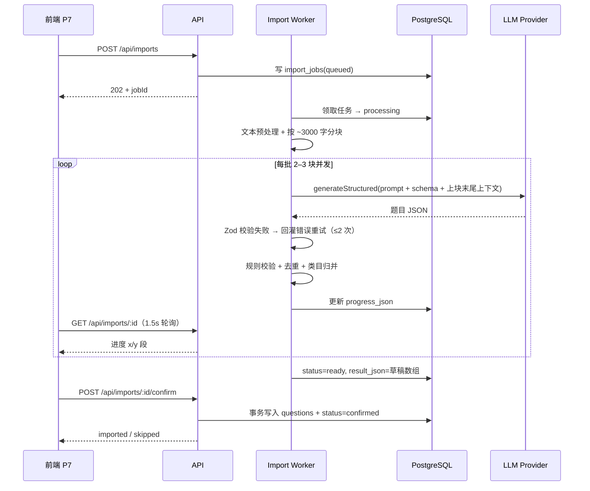

Worker 约束：

- 单次导入题目上限 **50**，超限置 `failed`，错误提示"请分批粘贴"。
- 服务启动时扫描 `processing` 任务，统一恢复为 `queued`（防止卡死）。
- 记录 `promptVersion`、`model`、`tokenUsage`，用于可观测性与成本控制。

### 6.9 统计模块

#### 6.9.1 GET /api/stats/:examId

- Path：`examId`。响应 `200`：

```json
{
  "examId": "exam_...",
  "total": 128,
  "passed": 79,
  "answerCount": 640,
  "errorCount": 80,
  "errorRate": 0.125,
  "pendingReview": 8,
  "categories": [
    {
      "id": "cat_...",
      "parentId": null,
      "name": "教育心理学",
      "total": 56,
      "passed": 31,
      "errorRate": 0.225
    }
  ]
}
```

- `pendingReview` = P3"错题本"卡片的"待订正"数。
- `categories` 读 `category_stats`，前端按 `parentId` 组织树。
- `errorRate = null` 表示"未练习"（灰胶囊），不是 0%。
- 错误：`404 NOT_FOUND`（考试越权）。

### 6.10 密钥缺失的前端引导链路（重点）

后端在需要 LLM 的接口上同步返回专用错误码，前端据此弹出"配置 / 取消"引导框。

**错误响应示例**（以 `POST /api/imports` 未配置 Key 为例）：

```json
{
  "statusCode": 422,
  "code": "LLM_KEY_NOT_CONFIGURED",
  "message": "该功能需要配置大模型密钥",
  "details": {
    "feature": "ai_import",
    "settingsPath": "/settings"
  },
  "requestId": "req_01HZY..."
}
```

- `details.feature`：`ai_import` 或 `short_answer_grading`，用于精确文案。
- `details.settingsPath`：固定 `/settings`，前端"配置"按钮跳转目标。
- `LLM_KEY_INVALID` 结构相同，`message` 为"大模型密钥无效或额度不足，请重新配置"，`details.feature` 一致。

**前端处理约定**：

1. 请求拦截器按 `code` 匹配（优先级高于通用错误提示）。
2. `LLM_KEY_NOT_CONFIGURED` / `LLM_KEY_INVALID` → 弹出确认框：
   - 标题："需要配置大模型密钥"
   - 正文：该功能的密钥提示（AI 导入 / 简答判分）
   - 按钮："配置"（跳 `details.settingsPath`）、"取消"（关闭，不做跳转）
3. 用户点"配置"跳转 `/settings`，配置完成返回后**不自动重放原操作**（一期不做进度恢复），由用户重新发起。
4. 这两个码**不触发** 401 的清理登录态逻辑。
5. 前端在调用前可先读 `GET /api/auth/me` 的 `llmConfig.configured` 做前置提示，但**仍必须处理后端返回的这两个错误码**（Key 可能在别处被清空或失效）。

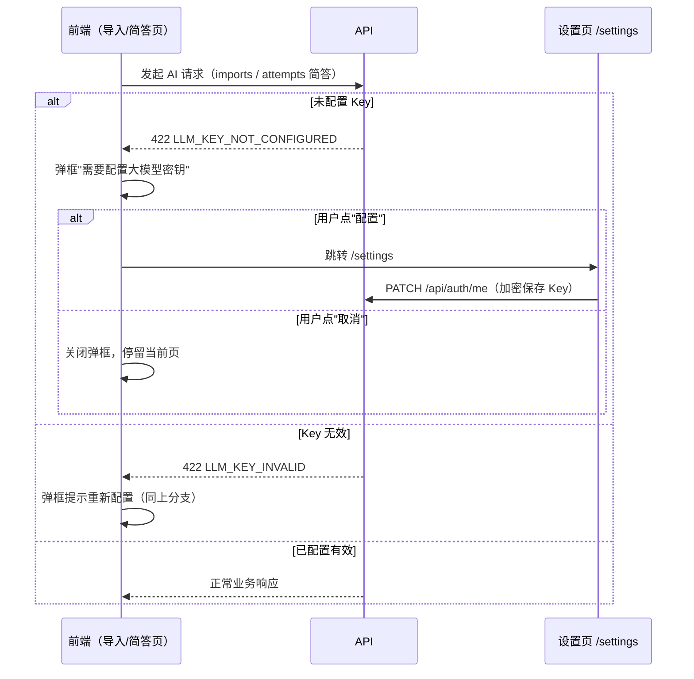

---

## 7. 简答题判分时序

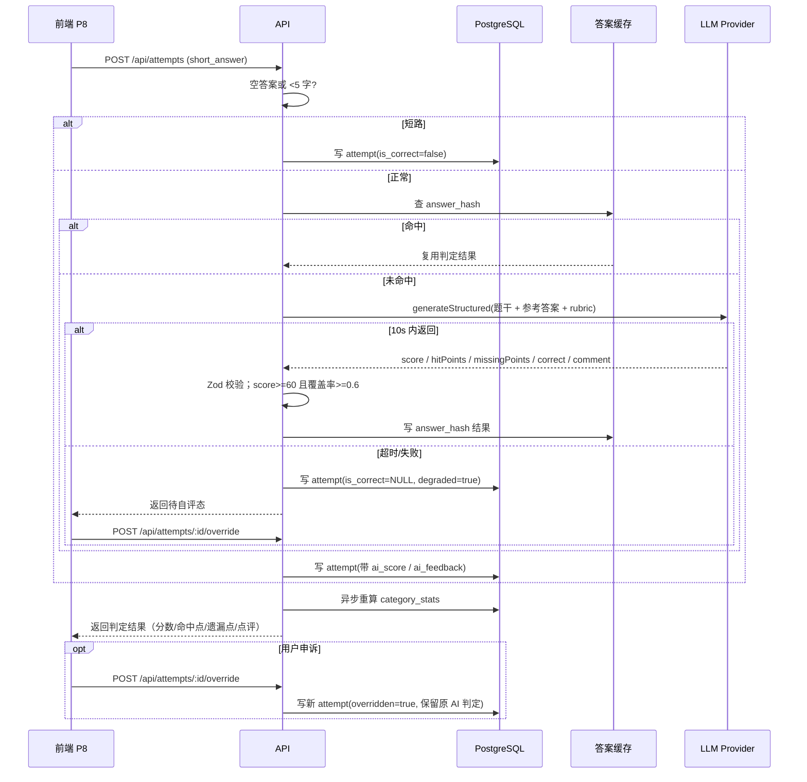

Provider 接口（来自实施计划 7.1，此处固化签名）：

```ts
interface LLMProvider {
  generateStructured<T>(input: {
    prompt: string;
    schema: ZodSchema<T>;
    signal?: AbortSignal;
    metadata?: Record<string, unknown>;
  }): Promise<T>;
}
```

一期实现 `DeepSeekProvider`；测试注入 `MockProvider`。

Provider 的凭证解析优先级：**当前用户的加密 Key（`user_llm_credentials`）> 无**。生产环境不使用全局 Key；`DEEPSEEK_API_KEY` 仅用于本地 / E2E 测试的 mock 注入。

环境变量：

```text
LLM_PROVIDER=deepseek
LLM_MODEL=deepseek-chat
LLM_TOKEN_ENCRYPTION_KEY=<32 字节随机串，用于加密存储用户 Key，必填>
DEEPSEEK_API_KEY=<仅测试环境使用，生产留空>
```

---

## 8. 数据隔离与安全

### 8.1 通用安全

| 风险 | 后端强制措施 |
|---|---|
| 用户越权读取他人数据 | 所有业务查询在 Prisma `where` 中强制注入 `user_id`；归属校验失败一律返回 `404`，不区分"不存在"与"非本人" |
| 删除类目残留脏数据 | 删除类目/考试用 `$transaction` 级联清理 questions、attempts、stats |
| 重复题干 | 数据库层 `unique(exam_id, stem_hash)` + 服务层预检；`confirm` 时二次校验防并发竞态 |
| 重复提交作答 | 前端按钮置灰；后端不额外加幂等键（一期 `attempts` 允许重复流水，统计按口径容纳） |
| LLM 成本失控 | 缓存 `answer_hash`；单次导入 ≤50 题；记录 `tokenUsage`；简答超时 10s 中止（用户自带 Key 后成本归用户，仍保留统计以观察用量） |
| Prompt 注入 | 用户输入文本作为数据插入模板，不拼接为指令；结构化输出强制 Zod 校验 |
| 敏感信息 | `password_hash`、`token_hash`、密钥密文绝不出现在任何响应；日志脱敏 `Authorization` 头 |

### 8.2 用户 LLM 密钥安全（重点）

密钥属于高敏感凭证，按"加密存储、最小暴露、全程可审计"设计。

**存储**

- 用户 Key **不明文落库**：用 AES-256-GCM 加密，落 `token_ciphertext` / `token_iv` / `token_tag` 三列；主密钥由环境变量 `LLM_TOKEN_ENCRYPTION_KEY` 提供（32 字节），**不入库、不进代码仓库**。
- `token_masked` 只存后 4 位掩码（如 `sk-****************abcd`），用于界面回显；`configured` 布尔值标识是否已配置。
- `user_id` 在 `user_llm_credentials` 上建唯一约束，一个用户一份配置。
- 密钥表与普通业务表分离，备份时单独加密，访问需显式 join，避免 `select * from users` 误带出密文。

**传输与暴露面**

- 仅接受 HTTPS（生产）；Key 只在 `PATCH /api/auth/me` 的请求体中出现一次。
- **任何响应都不返回完整 Key**：`GET /api/auth/me`、`PATCH /api/auth/me` 只回 `masked` 与 `configured`。
- 错误上报、链路追踪、APM 中对 `apiToken`、`token_ciphertext`、`Authorization` 字段统一脱敏（Fastify logger `redact`）。
- 日志中只记录 `userId + 操作类型 + 时间戳`，不记录 Key 本身或其派生哈希。

**前端配合（安全边界）**

- 前端**禁止把完整 Key 写入 localStorage / sessionStorage / IndexedDB**；现有 mock 中的 `llmConfig.apiToken` 明文存储需一并整改。
- 输入框用 `type="password"`，支持显示/隐藏切换；提交后立即从内存态清除明文，仅保留后端返回的 `masked`。
- 不把 Key 拼进 URL、查询参数或错误上报 payload。

**校验与轮换**

- 保存前可调用 `POST /api/auth/llm-config/verify` 做一次最小成本连通性校验（可选，见 6.1.7）。
- 更新即覆盖（`upsert`），旧密文立即清除；用户可主动清空（传 `apiToken: null`），`configured` 置 false。
- Provider 解析凭证失败（401/配额耗尽）返回 `LLM_KEY_INVALID`，提示用户重新配置，不自动回退到环境变量。

**与环境变量的关系**

- 一期以**用户自带 Key 为准**；`DEEPSEEK_API_KEY` 仅作为服务端测试的兜底（如 E2E 环境注入 mock），生产请求未配置用户 Key 时**直接报错**，不静默使用全局 Key，避免成本与责任不清。

---

## 9. 与前端契约对齐 / 待确认项

### 9.1 可直接对齐的部分

前端 `src/types.ts` 与 `src/api/client.ts` 定义的对象名、字段名、Input 结构与本文档一致：`AuthUser` / `AuthSession` / `Exam` / `Category` / `CategoryStats` / `Question` / `QuestionInput` / `Attempt` / `WrongBookItem` / `PracticeMode`。后端响应可直接被前端消费，无需改名。

### 9.2 必须确认的冲突

| 项 | 前端/设计稿 | 实施计划（本文档采用） | 处理 |
|---|---|---|---|
| 练习进度 | P8"退出保留进度/断点续答" | 一期不持久化、不恢复 | 后端不提供进度接口；前端去掉"保存进度"弹层，或标注二期 |

> **LLM Key 已定案（不再是冲突）**：用户自带 Key 正式启用，随用户信息在设置页配置，加密落库；未配置时 AI 接口返回 `LLM_KEY_NOT_CONFIGURED`，前端弹"配置 / 取消"引导框跳转设置页。完整设计见第 8.2、6.10 节。

### 9.3 建议补充的字段（前端类型需扩展）

| 接口 | 新增字段 | 原因 |
|---|---|---|
| `GET /api/questions` | `answerState: { passed, wrongCount, answerCount }` | P4 题单行需要三态与次数，避免前端 N+1 请求 |
| `POST /api/attempts` | `aiScore` / `aiFeedback` / `answerHash` / `originalAttemptId` | 简答判分、缓存与申诉的前端展示与状态判断 |
| 前端 `types.ts` `Attempt.isCorrect` | 允许 `null` | 简答超时降级时 `is_correct=NULL` |
| `AuthUser.llmConfig` | 改 `configured: boolean` + `apiTokenMasked: string \| null`，**移除明文字段 `apiToken`** | 密钥脱敏；回显掩码，提交时用单独字段传新 Key |
| 全部 AI 接口错误 | 识别 `LLM_KEY_NOT_CONFIGURED` / `LLM_KEY_INVALID` | 触发配置引导弹窗（6.10） |

### 9.4 一期新增但实施计划未列的接口

为保持前端现有调用链完整，本文档补充了 3 个接口，建议同步写入实施计划的接口清单：

- `PATCH /api/auth/me`（前端 `updateProfile`，现同时承担密钥配置入口）
- `POST /api/attempts/:id/override`（简答自评/申诉，实施计划只在业务描述中提及）
- `POST /api/imports/:id/retry`（实施计划第 10 步要求"失败可重放"）
- `POST /api/auth/llm-config/verify`（密钥连通性校验，可选）

---

## 10. 实现检查清单

- [ ] Prisma schema 落 9 张表（含 `user_llm_credentials`），`unique(exam_id, stem_hash)`、`refresh_tokens`、`user_llm_credentials.user_id` 索引就位
- [ ] Zod schemas 收敛到 `packages/shared`，前后端不重复定义
- [ ] 鉴权中间件 + 401/403/404/409/422 统一错误结构，含 `LLM_KEY_NOT_CONFIGURED` / `LLM_KEY_INVALID`
- [ ] 所有查询强制带 `user_id`，并补数据隔离测试
- [ ] 用户 Key：AES-256-GCM 加密存储，主密钥走环境变量；任何响应不含明文
- [ ] 密钥门禁：简答正常判定、AI 导入创建任务前同步校验 Key，未配置不写库、立即报错
- [ ] 短路判错与缓存命中不校验 Key，不受密钥缺失影响
- [ ] 客观题服务端判定：单选/多选/填空
- [ ] 简答：短路、缓存、10s 超时、Zod 校验、申诉新增流水不改原记录
- [ ] 导入：分块并发、跨块上下文、重试降级、去重、类目归并、50 题上限、进度轮询
- [ ] 服务重启恢复 `processing` → `queued`
- [ ] `category_stats` 异步重算当前节点及父链
- [ ] 错题本按 4.3 派生，答对后 `corrected=true` 且不计入待刷
- [ ] 契约测试覆盖本文档第 6 章全部接口，含密钥错误码分支

